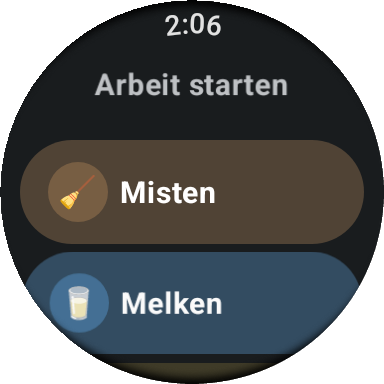
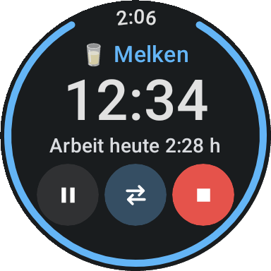
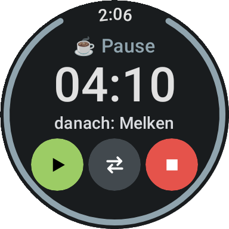
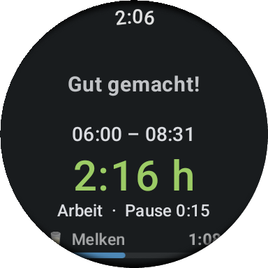
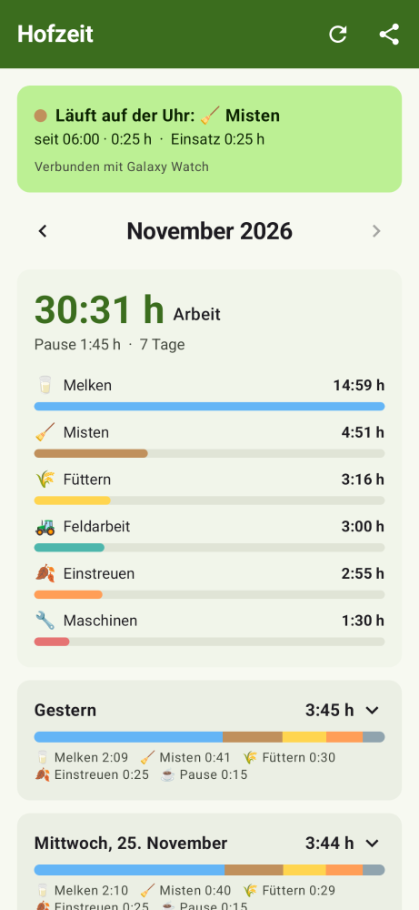

# Hofzeit: Stoppuhr für die Arbeit auf dem Hof

Funktioniert wie ein Workout in Samsung Health, nur für Hofarbeiten: Du tippst auf der Uhr
**Misten**, **Melken**, **Füttern** usw. an, die Zeit läuft. Zwischendurch drückst du **Pause**
oder **wechselst** direkt zur nächsten Arbeit. Mit **Beenden** siehst du, wie lange du für was
gebraucht hast. Die Handy-App sammelt alles und schickt dir den Monat als Tabelle.

Für **Galaxy Watch 4 oder neuer** (Wear OS) und ein **Android-Handy**.

| Start | Arbeit läuft | Pause | Fertig |
|:-:|:-:|:-:|:-:|
|  |  |  |  |

| Handy: Monatsübersicht |
|:-:|
|  |

---

## 1. Herunterladen

Beide Apps liegen hier, immer in der neuesten Version:
**<https://github.com/chrigur8spyder-blip/baustellenprotokoll/releases/tag/hofzeit-neueste>**

- `Hofzeit-Uhr.apk` kommt auf die Uhr.
- `Hofzeit-Handy.apk` kommt aufs Handy.

Lade beide Dateien **auf dem Handy** herunter (im Browser antippen).

## 2. Handy-App installieren (2 Minuten)

1. In den Downloads `Hofzeit-Handy.apk` antippen.
2. Fragt Android nach «Unbekannte Apps installieren», das für den Browser bzw. «Eigene Dateien»
   erlauben.
3. **Installieren** tippen. Fertig.

## 3. Uhr-App installieren (einmalig etwa 10 Minuten)

Weil die App nicht im Play Store ist, braucht es einmal die Entwickleroptionen der Uhr.
Die Menünamen können je nach Uhr und Softwarestand leicht abweichen.

**Uhr vorbereiten**

1. Uhr und Handy ins **gleiche WLAN**.
2. Auf der Uhr: **Einstellungen → Info zur Uhr → Softwareinformationen**, dann
   **5× auf «Softwareversion»** tippen, bis «Entwicklermodus aktiviert» erscheint.
3. **Einstellungen → Entwickleroptionen** (ganz unten):
   **ADB-Debugging** einschalten und **Debugging über WLAN** einschalten.
4. In **Debugging über WLAN** auf **Neues Gerät koppeln** tippen. Die Uhr zeigt jetzt eine
   IP-Adresse mit Port und einen Kopplungscode an. Diesen Bildschirm offen lassen.

**Mit dem Handy auf die Uhr schicken**

1. Auf dem Handy aus dem Play Store **«Wear Installer 2»** installieren (Alternativen:
   «Bugjaeger», «Easy Fire Tools»).
2. In der App die **IP-Adresse der Uhr** eingeben und mit dem **Kopplungscode** koppeln
   (die App führt dich durch die Schritte).
3. Als Datei **`Hofzeit-Uhr.apk`** aus den Downloads wählen und installieren.
4. Auf der Uhr erscheint **Hofzeit** in der App-Liste. Beim ersten Start
   **Benachrichtigungen erlauben**, damit die laufende Arbeit auf dem Zifferblatt angezeigt wird.
5. Danach in den Entwickleroptionen **ADB-Debugging wieder ausschalten** (spart Akku).

<details>
<summary>Mit einem Computer statt mit dem Handy</summary>

Mit den Android Platform Tools (`adb`) und den Angaben von der Uhr:

```
adb pair 192.168.1.50:41234        # IP:Port und Code von «Neues Gerät koppeln»
adb connect 192.168.1.50:5555      # IP:Port von «Debugging über WLAN»
adb install Hofzeit-Uhr.apk
```
</details>

**Neue Version?** Gleich wie oben installieren, ohne vorher zu löschen. Die erfassten Zeiten
bleiben erhalten.

---

## So geht's auf der Uhr

- **Starten:** Hofzeit öffnen, Tätigkeit antippen. Die Uhr vibriert, die Zeit läuft.
- **Knöpfe beim Arbeiten:**
  - ⏸ **Pause** hält an, ▶ **Weiter** macht mit der gleichen Arbeit weiter.
  - ⇄ **Wechseln** springt direkt zur nächsten Arbeit, ohne zu stoppen.
  - ■ **Beenden** fragt nach, danach erscheint die Zusammenfassung.
- **Zifferblatt:** Solange etwas läuft, zeigt ein kleines Stoppuhr-Symbol die laufende Arbeit.
  Antippen bringt dich zurück in die App.
- **Handgelenk unten:** Ist «Always On Display» eingeschaltet, bleiben Uhrzeit, Tätigkeit und
  Dauer sichtbar.
- **Vertippt?** Abschnitte unter 5 Sekunden werden verworfen. Falsch angetippt und gleich
  gewechselt, das bleibt also nicht im Verlauf.
- **Heute:** zeigt, wie viel Zeit heute in welche Arbeit ging.
- **Verlauf:** alle Einsätze, antippen für Details oder zum Löschen.
  **An Handy senden** schickt alles nochmals ans Handy.
- **Tätigkeiten:** eigene hinzufügen (**sprechen oder tippen**), nicht benötigte entfernen,
  oft gebrauchte **ganz nach oben** schieben.

## So geht's auf dem Handy

- Nach jedem **Beenden** schickt die Uhr den Einsatz automatisch ans Handy, auch später,
  falls das Handy gerade nicht in der Nähe ist.
- Oben siehst du, was gerade auf der Uhr läuft.
- **Monat** wechseln mit ‹ ›, **Tag antippen** zeigt jeden Abschnitt mit Uhrzeit.
- **↻** holt alle Zeiten nochmals von der Uhr.
- **Teilen** (oder «Monat als Tabelle teilen») verschickt zwei Dateien per Mail, WhatsApp, Drive …:
  - `Hofzeit_2026-11_Tage.csv`: eine Zeile pro Tag, eine Spalte pro Tätigkeit, mit Summe.
  - `Hofzeit_2026-11_Eintraege.csv`: jeder Abschnitt mit Von/Bis.

  Beide lassen sich in Excel, Numbers oder Google Tabellen öffnen.

## Gut zu wissen

- Die Daten bleiben **auf deiner Uhr und deinem Handy**, es gibt keine Cloud und kein Konto.
- Uhr und Handy tauschen nur Daten aus, wenn **beide Apps von hier** stammen.
  Sie sind mit demselben Schlüssel signiert (`signing/hofzeit.jks`).
  Dieser Schlüssel liegt bewusst im Repository, damit jede neue Version als Update passt.
  Das ist für eine private App so gedacht.

---

## Technik (für Entwickler)

- `core/`: Kotlin ohne Android: Datenmodell, Zeitlogik, CSV-Export, Tests.
- `wear/`: Uhr-App, Jetpack Compose for Wear OS, Ongoing Activity, Always-On.
- `mobile/`: Handy-App, Jetpack Compose Material 3.
- Übertragung über den Wearable Data Layer (`/hofzeit/session/<id>`, `/hofzeit/running`).

Bauen: `cd hofzeit && ./gradlew assembleRelease` (Android SDK nötig). GitHub Actions
(`.github/workflows/hofzeit.yml`) baut bei jedem Push beide APKs, erzeugt die Bilder
(Paparazzi) und aktualisiert das Release `hofzeit-neueste`.
